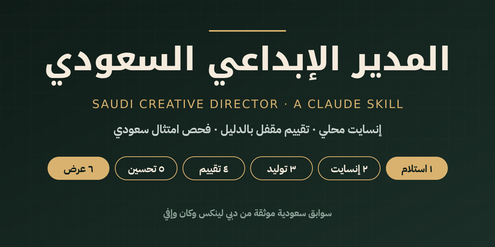

<p align="center">
  
</p>

<p align="center">
  <b>A Claude skill for advertising creativity in Saudi Arabia.</b><br>
  <a href="#english">English</a> · <a href="#arabic">العربية</a> · <a href="examples/real-estate-north-riyadh.md">See a full example</a>
</p>

---

<a id="english"></a>

## English

**Saudi Creative Director** turns Claude into a senior creative director for the Saudi and Gulf market. It mines a real local insight, generates ideas with structured methods, judges them with evidence-locked scoring and an independent cold judge, checks Saudi ad compliance, and delivers presentation-ready concepts in Saudi Arabic.

### Why it exists

Generic AI creative tools produce ideas that are translated, not local, and they grade their own work generously. Popular creative skills ship case libraries that are almost entirely Western. This skill fixes that for Saudi Arabia.

### What makes it different

- **Saudi canon**: documented Saudi and Gulf cases, including Grand Prix winners at Dubai Lynx, Lions at Cannes, and Effie Saudi winners, each linked to a public source. No invented cases or numbers.
- **Evidence-locked scoring**: every score needs a line of evidence, scores are reported as ranges with a confidence level, and an independent judge reviews the top ideas without seeing the original scores.
- **Saudi compliance gate**: Mawthooq influencer licensing, Ministry of Commerce discount permits, REGA real estate ad licences (including the May 2026 rules), SFDA claim approval, and the ban on commercial use of the national flag and emblem.
- **Local culture built in**: Saudi calendar, platforms (Snapchat-first), dialect guidance, red lines, and local humour (طقطقة).
- **Sector playbooks**: real estate, coffee and F&B, automotive, retail, B2B tech, services, entertainment, non-profit.
- **Three modes**: quick, standard and deep, so you do not burn tokens on a simple request.

### Install

- **Claude app**: download `saudi-creative-director.zip` from this repo and upload it in Settings under Skills.
- **Claude Code**: `cp -r saudi-creative-director ~/.claude/skills/`

### Try it

> "I need a campaign idea for a real estate developer in north Riyadh, young families, goal is qualified leads."

See the [full worked example](examples/real-estate-north-riyadh.md) (in Arabic).

---

<a id="arabic"></a>

<div dir="rtl">

# المدير الإبداعي السعودي

مهارة لـ Claude تخليه يشتغل كمدير إبداعي في وكالة إعلانات سعودية: يطلع إنسايت حقيقي من السوق المحلي، ويولد أفكار حملات بطرق تفكير منظمة، ويقيّمها بصرامة، ويتأكد إنها نظامية ومناسبة ثقافياً، ثم يسلمها جاهزة للعرض على العميل بالعامية السعودية.

---

## وش تسوي

تمر الفكرة بست مراحل:

1. **استلام** البريف: تستخرج المنتج والجمهور والهدف والقيود والمناسبة والقطاع، وتحدد مستوى الفكرة المطلوبة.
2. **الإنسايت**: تستخرج حقيقة إنسانية من الواقع السعودي بسبع تقنيات.
3. **التوليد**: تقرأ السوابق المحلية أولاً، ثم تولد من ثمان إلى اثنتي عشرة فكرة بثلاث طرق تفكير من فئات مختلفة.
4. **التقييم**: بوابات نجاح ورسوب (منها الامتثال والثقافة)، ثم درجة على ستة معايير، كل درجة لازم يكون معها دليل، ثم حكم بارد مستقل يراجع.
5. **التحسين**: جولات محدودة تركز على المعايير الضعيفة.
6. **العرض**: قوالب عربية جاهزة للعميل.

---

## وش الفرق عن المهارة الأصلية

هذي المهارة مستوحاة من منهجية [creative-director-skill](https://github.com/smixs/creative-director-skill)، ومبنية من جديد عشان تعالج عيوبها في السوق السعودي:

| العيب في الأصلية | الحل هنا |
|---|---|
| المكتبة غربية تقريباً بالكامل (حملة وحدة من الشرق الأوسط من 571) | سوابق سعودية وخليجية فائزة بجوائز إقليمية وعالمية، وإعلانات وكالات سعودية نجحت في السوق المحلي (هبار، TTP)، وكل وحدة معها رابط مصدر |
| قرابة 43٪ من البطاقات ناقصة أو غير مؤكدة | كل بطاقة متحقق منها، وممنوع إضافة أرقام من الذاكرة |
| النموذج يقيّم نفسه بأرقام توهم بالدقة | الدرجة كمدى مع مستوى ثقة، ودليل إلزامي لكل درجة، وحكم بارد مستقل، ومراسي معايرة من حملات نعرف نتائجها |
| تستهلك رصيد كثير في كل طلب | ثلاثة أوضاع: سريع وقياسي وعميق، وعدد جولات محدود |
| ما تعرف الأنظمة السعودية | فحص امتثال حسب القطاع: موثوق، ترخيص التخفيضات، ترخيص الإعلان العقاري، هيئة الغذاء والدواء، أنظمة العلم والرموز |
| ما تفهم الثقافة المحلية | ملف كامل عن التقويم والثقافة والمنصات واللهجات والخطوط الحمراء |
| قوالب عامة | زوايا جاهزة حسب القطاع: عقار، قهوة ومطاعم، سيارات، تجزئة، تقنية للشركات، خدمات، ترفيه |
| المخرجات بالإنجليزي أو الروسي | كل شي بالعربي، مع قواعد كتابة تحافظ على اتجاه النص |

---

## محتوى المستودع

```
saudi-creative-director/
├── SKILL.md                       ← التعليمات الأساسية والمراحل الست
└── references/
    ├── saudi-context.md           ← التقويم والثقافة والمنصات واللهجات والخطوط الحمراء
    ├── compliance.md              ← فحص الامتثال حسب القطاع مع المصادر الرسمية
    ├── saudi-canon.md             ← سوابق سعودية وخليجية موثقة، منها أعمال هبار وTTP
    ├── insight-mining.md          ← تقنيات الإنسايت مع أمثلة محلية
    ├── methods.md                 ← اثنتا عشرة طريقة توليد وجدول اختيار
    ├── patterns.md                ← سبعة عشر نمطاً للأفكار الكبرى، منها الطقطقة المحلية
    ├── scoring.md                 ← سلّم التقييم المقفل بالدليل
    ├── sector-playbooks.md        ← زوايا حسب القطاع
    ├── idea-levels.md             ← مستويات الأفكار
    └── output-templates.md        ← قوالب العرض

examples/                          ← مثال كامل لمخرج المهارة
assets/                            ← صورة الغلاف
```

---

## التثبيت

**في تطبيق Claude**: نزّل ملف `saudi-creative-director.zip` من هذا المستودع، وارفعه من قسم المهارات في الإعدادات.

**في Claude Code**:

```bash
git clone https://github.com/A-Najjar/saudi-creative-director.git
cp -r saudi-creative-director/saudi-creative-director ~/.claude/skills/
```

---

## مثال كامل

شوف [مثال كامل لمطور عقاري في شمال الرياض](examples/real-estate-north-riyadh.md): البريف، والإنسايت، وثلاث أفكار مقيمة بالدليل، ورأي الحكم البارد، والامتثال، والتوصية.

---

## أمثلة استخدام

- **أبي** فكرة حملة لمطور عقاري في شمال الرياض، الجمهور عائلات شابة، والهدف ليدز.
- **عندي** مقهى مختص وأبي فكرة لليوم الوطني، الميزانية صغيرة.
- **قيّم** هذي الفكرة: [الفكرة].
- **طلّع** لي إنسايت لمحل تعديل سيارات.
- **أبي** خمس أفكار سريعة لسناب في رمضان لتطبيق توصيل.
- **ابني** منصة حملة لسنتين لبراند ملابس رجالية.

---

## الترخيص

المحتوى منشور تحت [CC BY 4.0](https://creativecommons.org/licenses/by/4.0/). المنهجية العامة مستوحاة من [smixs/creative-director-skill](https://github.com/smixs/creative-director-skill) (CC BY 4.0، تأليف Serge Shima). أسماء الحملات والبراندات ملك أصحابها، وهي مذكورة لأغراض التحليل والتعليم مع روابط المصادر.

</div>
